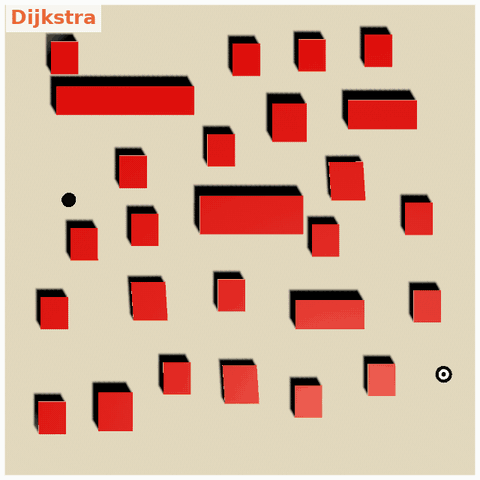
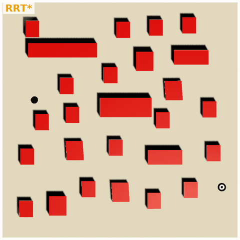
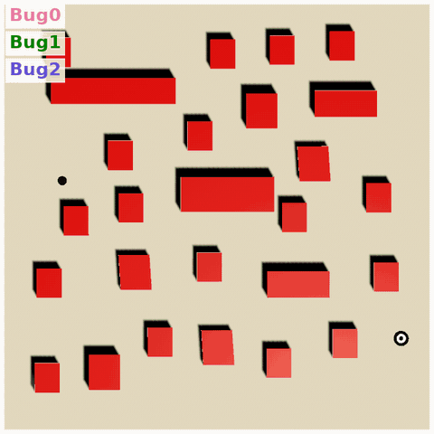
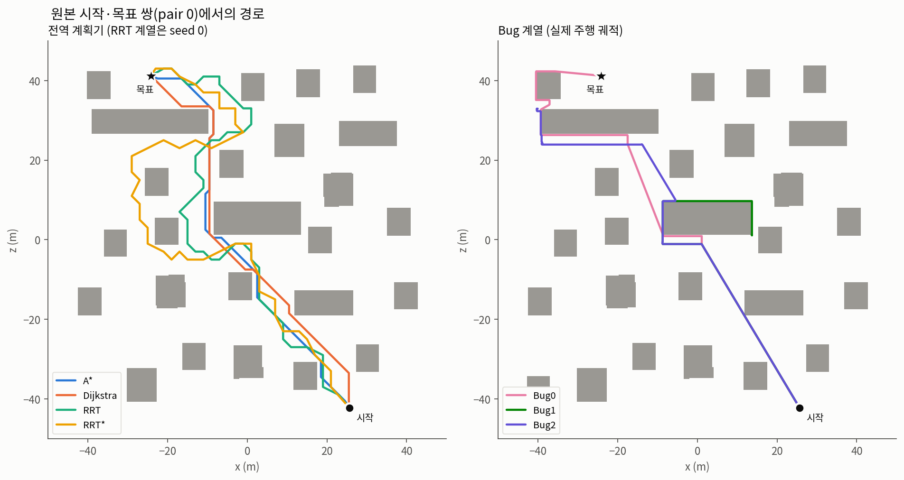
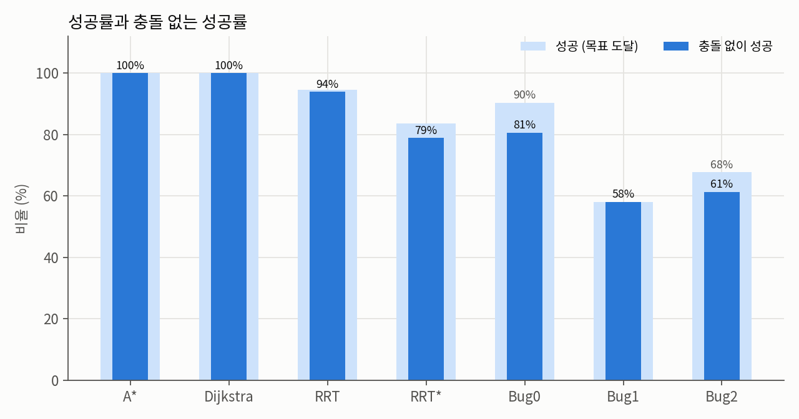
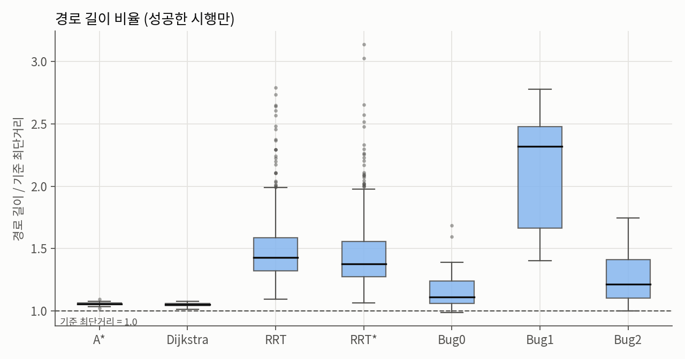

# 모바일 로봇 경로계획 알고리즘 구현과 정량 비교 (Unity)

Bug0/1/2, Dijkstra, A\*, RRT, RRT\* 일곱 가지 경로계획 알고리즘을 Unity로 구현했습니다. 같은 장애물 맵과 같은 시작·목표 쌍에서 성공률, 계획 시간, 경로 길이, 충돌 여부를 측정해 비교했습니다.

[unity-mobile-robot-turnover-prevention](https://github.com/ukhyeon/unity-mobile-robot-turnover-prevention)(ZMP 기반 전복 방지)에서 경로계획 부분만 분리한 저장소이고 커밋 이력도 그대로 가져왔습니다.

> 📒 **알고리즘 설명, 실험 설정, 결과 해석 전체는 [Notion 문서](https://app.notion.com/p/327fcf2876fa80fb891ffb8a122fb7b9)(「경로계획 알고리즘 정량 비교」 토글)에 있습니다.** 이 README에는 요약만 남겼습니다.

| A\* | Dijkstra |
|:---:|:---:|
|  |  |
| 휴리스틱 덕분에 목표 쪽으로만 탐색 (486 노드) | 모든 방향으로 고르게 퍼짐 (7,682 노드) |
| **RRT** | **RRT\*** |
|  |  |
| 무작위 트리 확장, 지그재그 경로 | rewire로 일부 개선되지만 여전히 우회 |

<p align="center"></p>
<p align="center">Bug0 · Bug1 · Bug2 동시 주행. Bug1은 장애물마다 한 바퀴를 돈 뒤 빠져나가서 가장 늦게 도착합니다.</p>

> 모든 GIF는 같은 시작(●)과 목표(◎)를 쓰고(평가 쌍 pair 29) 1배속으로 재생됩니다. 파란 영역은 탐색한 노드를 비용 순서대로 다시 재생한 것이고 회색 선은 RRT 트리입니다. 원본 시각화는 `OnDrawGizmos`라 카메라 렌더에 찍히지 않아서 녹화 스크립트(`Assets/Benchmark/DemoRecorder.cs`)가 알고리즘 상태를 읽어 다시 그렸습니다.

## 알고리즘

| 알고리즘 | 방식 | 이 구현의 특징 |
|---|---|---|
| Bug0 | 목표로 직진하다 장애물을 만나면 경계를 따라가고 목표 방향이 열리면 다시 직진 | 8방향 레이캐스트(3 m)로 장애물 감지 |
| Bug1 | 장애물 경계를 한 바퀴 돌며 목표와 가장 가까운 점을 기록한 뒤 그 점에서 이탈 | 경로는 길지만 이탈 지점 선택이 체계적 |
| Bug2 | 시작과 목표를 잇는 M-line에 다시 닿으면 경계 추종을 멈추고 직진 | M-line은 격자 노드 목록으로 저장 |
| Dijkstra | 비용이 가장 낮은 노드부터 넓혀 가는 최단경로 탐색 | 8-연결 격자(셀 1 m), 이동 비용 10/14 |
| A\* | Dijkstra에 목표까지의 휴리스틱(octile 거리)을 더함 | `Heap<T>` 우선순위 큐 |
| RRT | 무작위 점 방향으로 트리를 한 걸음씩 확장 | 2 m 격자 노드에 스냅, step 3 m, 최대 2000회 |
| RRT\* | RRT에 반경 안 노드의 부모를 다시 연결하는 rewire 추가 | step 4 m, 최대 1200회, rewire 반경 6 m |

## 정량 평가 요약

- **조건**: A\*/Dijkstra/RRT/RRT\* 씬이 공유하는 100×100 m 맵(박스 장애물 26개)에서, 시작·목표 31쌍(원본 1 + 무작위 30)을 모든 알고리즘에 똑같이 적용했습니다. 무작위 쌍은 직선 경로가 장애물로 막힌 쌍만 골랐습니다.
- **반복**: RRT/RRT\*는 쌍마다 시드 20개(쌍당 20회)로 돌렸습니다. 알고리즘 코드와 씬 파라미터는 원본 그대로입니다.
- **길이 비율**은 0.25 m 격자 최단경로에 가시선 단축을 적용한 기준 최단거리로 나눈 값입니다(1.0 = 최단).

| 알고리즘 | 성공률 | 충돌 없는 성공률 | 계획 시간 중앙값 | 탐색 노드 | 길이 비율 | 최소 이격 |
|---|---:|---:|---:|---:|---:|---:|
| A\* | 100% | 100% | **0.32 ms** | 610 | 1.057 | 0.57 m |
| Dijkstra | 100% | 100% | 5.19 ms | 5,299 | **1.050** | 0.54 m |
| RRT | 94.5% | 93.9% | 2.27 ms | 314 | 1.492 | 1.04 m |
| RRT\* | 83.7% | 78.9% | 1.60 ms | 216 | 1.448 | 0.85 m |
| Bug0 | 90.3% | 80.6% | (실시간 주행) | - | 1.171 | 0.04 m |
| Bug1 | 58.1% | 58.1% | (실시간 주행) | - | 2.139 | 0.08 m |
| Bug2 | 67.7% | 61.3% | (실시간 주행) | - | 1.276 | 0.08 m |

<p align="center"></p>

| 성공률 | 경로 길이 비율 |
|:---:|:---:|
|  |  |

### 주요 발견

- **A\*가 가장 효율적입니다.** Dijkstra와 경로 품질은 거의 같은데(길이 비율 1.06 vs 1.05), 노드를 8.7배 적게 열고 16배 빠릅니다.
- **RRT/RRT\*의 실패는 대부분 무한 루프 버그입니다.** 새 노드가 목표와 같은 격자 노드에 떨어지면 `targetNode.parent`가 자기 자신을 가리켜 `RetracePath`가 끝나지 않습니다. RRT 실패 34건 중 28건, RRT\* 101건 중 93건이 이 경우였습니다.
- **RRT/RRT\*는 간선 충돌 검사가 없습니다.** 새 노드 위치만 검사해서 성공한 경로 중 RRT 4건, RRT\* 30건이 장애물을 관통했습니다. RRT\*는 choose-parent 단계가 없고 목표에 닿자마자 멈추기 때문에 RRT보다 크게 짧아지지 않았습니다.
- **A\*/Dijkstra는 `Heap.UpdateItem()`을 호출하지 않습니다.** 그래서 힙 순서가 어긋나 31쌍 중 23쌍에서 A\* 경로가 Dijkstra보다 약간 길었습니다(최대 +2.0 m).
- **Bug 계열은 벽에 붙어 다닙니다**(최소 이격 0.04~0.08 m). 이 맵처럼 볼록한 장애물이 흩어진 환경에서는 Bug0이 가장 잘 작동했고 Bug1/Bug2는 모서리에서 맴돌다 30~42%가 시간 초과로 실패했습니다.
- 모든 구현이 로봇을 점으로 보기 때문에, 실제 로봇(반경 1.5 m)에 쓰려면 장애물 팽창이 필요합니다.

> RRT/RRT\*의 `RetracePath`에는 측정용 안전장치가 들어 있습니다. 위 무한 루프를 끊고 해당 시행을 실패로 기록하는 것이고 그 외 동작은 원본과 같습니다.

## 실행 방법

1. Unity **2021.3.36f1**로 이 폴더를 엽니다(Unity Hub → *Add project from disk*). `Library/`는 처음 열 때 자동으로 생성됩니다.
2. `Assets/Scenes/`에서 알고리즘별 씬(`Bug`, `Dijkstra`, `Astar`, `RRT`, `RRTstar`)을 열고 Play를 누릅니다. Scene 뷰에서 Gizmos를 켜면 격자, 탐색 트리, 경로가 보입니다.
3. 정량 평가와 데모 GIF는 아래 명령으로 다시 만들 수 있습니다. 에디터 메뉴 **Tools > Path Planning Benchmark**에서도 실행할 수 있습니다.

```bash
# 정량 평가 → BenchmarkResults/*.csv
Unity -batchmode -nographics -projectPath . -executeMethod Benchmark.BenchmarkLauncher.RunBatch -logFile bench.log
python3 Tools/analyze_benchmark.py          # 요약표·그림 (pandas, matplotlib, scipy)

# 데모 GIF → docs/images/demo_*.gif (렌더링이 필요하므로 -nographics 없이)
Unity -batchmode -projectPath . -executeMethod Benchmark.BenchmarkLauncher.RecordDemoBatch -logFile demo.log
Tools/make_gifs.sh                          # ffmpeg
```

## 코드 구조

```
Assets/
├── Scenes/                     # Bug, Dijkstra, Astar, RRT, RRTstar 씬
├── Scripts/
│   ├── Bug/                    # Bug0/1/2Seeker, Grid, Node            (namespace base2)
│   ├── Dijkstra/               # Pathfinding, Grid, Node, Heap, Unit   (namespace Dijkstra)
│   ├── Astar/                  # Pathfinding, Grid, Node, Heap, Unit   (namespace Astar)
│   ├── RRT/ , RRTstar/         # Pathfinding, Grid, Node, Unit         (namespace RRT / RRTstar)
│   └── Common/CameraController.cs
└── Benchmark/
    ├── PathPlanningBenchmark.cs  # 정량 평가 하네스 (알고리즘 코드는 리플렉션으로만 초기화)
    ├── DemoRecorder.cs           # README GIF용 프레임 녹화
    └── Editor/BenchmarkLauncher.cs
BenchmarkResults/               # 원자료(csv), summary.md, figures/
Tools/                          # analyze_benchmark.py, make_gifs.sh
docs/images/                    # 데모 GIF
```

알고리즘마다 폴더와 namespace가 따로 있어서 같은 이름의 클래스(`Grid`, `Node`, `Pathfinding` 등)가 있어도 서로 충돌하지 않습니다. 공통 구조는 이렇습니다.

- **Grid / Node**: 격자 기반 공간 표현. `unwalkableMask` 레이어(Unwalkable)로 장애물 노드를 판정합니다.
- **Pathfinding**: 알고리즘 본체입니다.
- **PathRequestManager / Unit**: 경로 요청을 큐로 처리하고 `Unit`이 받은 경로를 따라 `target`까지 이동합니다.

## 관련 저장소

- [unity-mobile-robot-turnover-prevention](https://github.com/ukhyeon/unity-mobile-robot-turnover-prevention): 같은 Unity 프로젝트에서 출발한 ZMP·TSI 기반 전복 방지 시뮬레이션(학사학위논문). A\* 경로계획에 Box Blur 비용 평활화를 더해 썼습니다.
